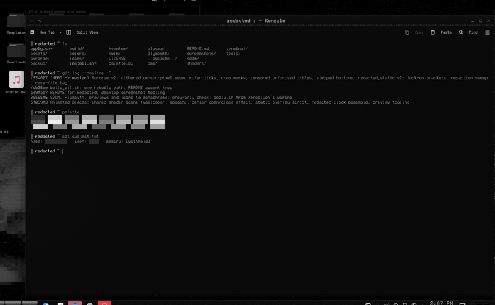
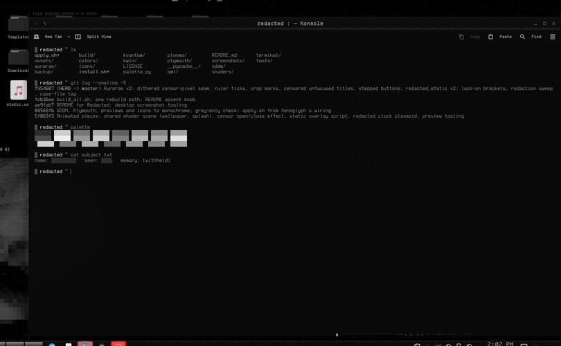

# Redacted — Static (KWin script)

Puts the active window under review. Corner brackets lock onto it when it takes focus, a write head crawls its edge stamping censor bars that decay into mosaic, and a case-file tag censors its title.



Redacted is a monochrome-black look for KDE Plasma 6 about obfuscation and censorship. Every colour is a neutral grey, and the accents sit only a few levels above black: almost imperceptible, but just perceptible. The motifs are static, mosaic pixelation, black censor bars and a dissociated double.

## Features

- **Lock-on:** when a window takes focus, four corner brackets snap onto it in hard steps, like a camera acquiring a subject. They blink once and cut out, then re-acquire every 24 s.
- **Sweep:** a write head crawls clockwise round the frame edge. Behind it, black censor bars are stamped onto the hairline. Each bar breaks into a few 3 px censor pixels and then disappears.
- **Case file:** above the top-left corner sits `FILE 0x....`, a hex number derived from the app. It scrambles while the brackets acquire, then settles. Next to it, the window title appears as censor bars, one per word.
- **Light:** one click-through overlay that redraws at most 10 times a second, and only while visible. It hides for maximised, fullscreen and non-normal windows.



## Requirements

KWin 6 (Plasma 6). The tag uses Departure Mono Nerd Font if it is installed; otherwise it falls back to the default mono font.

## Install

```bash
git clone https://github.com/numbpill3d/redacted-static
cd redacted-static && ./install.sh
```

Or from the KDE Store: Extract it to `~/.local/share/kwin/scripts/`, then enable **Redacted Static** in System Settings → Window Management → KWin Scripts.

## The rest of the suite

| piece | repo |
|---|---|
| Global theme + splash screen | [redacted-global](https://github.com/numbpill3d/redacted-global) |
| Plasma style (panel, popups) | [redacted-plasma](https://github.com/numbpill3d/redacted-plasma) |
| Aurorae window decoration | [redacted-aurorae](https://github.com/numbpill3d/redacted-aurorae) |
| Colour scheme | [redacted-colors](https://github.com/numbpill3d/redacted-colors) |
| Kvantum widget style | [redacted-kvantum](https://github.com/numbpill3d/redacted-kvantum) |
| Icon theme | [redacted-icons](https://github.com/numbpill3d/redacted-icons) |
| Konsole + kitty colours | [redacted-konsole](https://github.com/numbpill3d/redacted-konsole) |
| SDDM login | [redacted-sddm](https://github.com/numbpill3d/redacted-sddm) |
| Plymouth boot splash | [redacted-plymouth](https://github.com/numbpill3d/redacted-plymouth) |
| Animated wallpaper (desktop + lock) | [redacted-wallpaper](https://github.com/numbpill3d/redacted-wallpaper) |
| Still wallpaper (1080p–4K) | [redacted-image-wallpaper](https://github.com/numbpill3d/redacted-image-wallpaper) |
| KWin open/close effect | [redacted-censor](https://github.com/numbpill3d/redacted-censor) |
| Clock plasmoid | [redacted-clock](https://github.com/numbpill3d/redacted-clock) |

Everything at once, with the generators: [redacted-kde](https://github.com/numbpill3d/redacted-kde).

## Tags

`redacted` `kde` `plasma6` `dark` `black` `monochrome` `grayscale` `minimal` `censored` `glitch` `static` `pixel` `kwin-script` `kwin` `overlay` `focus-indicator` `qml`

## Credits and licence

By splicer scorn (voidrane). GPL-3.0-or-later.
